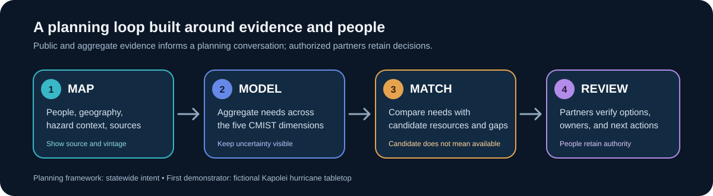
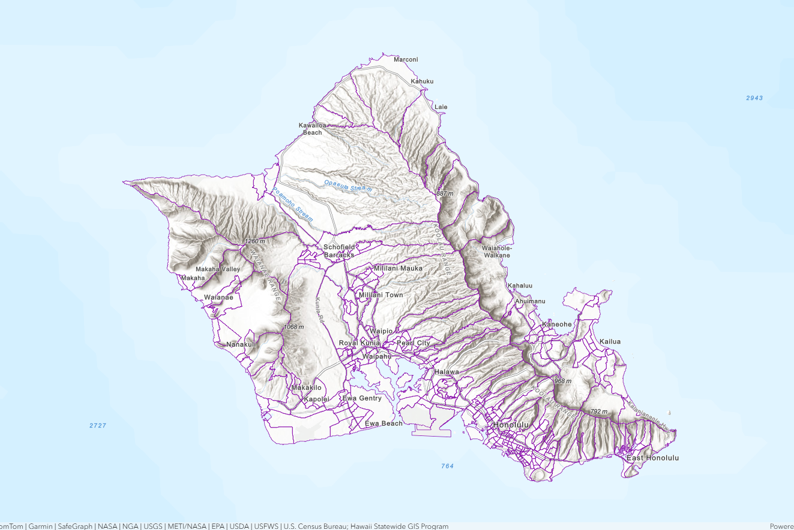
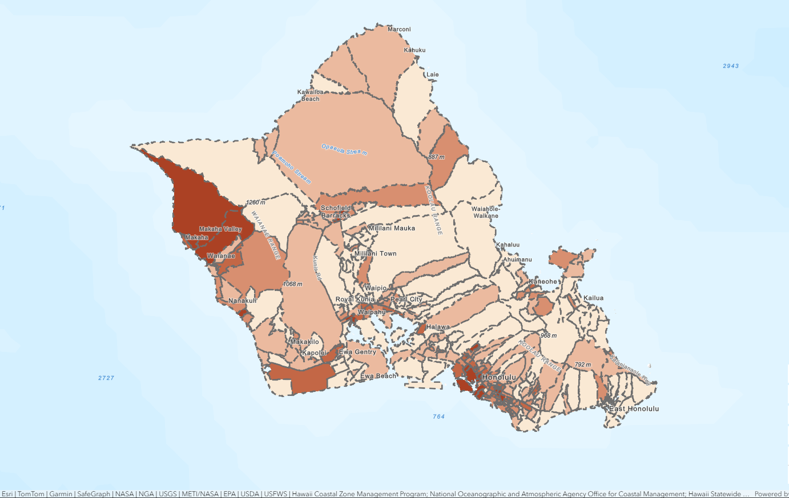
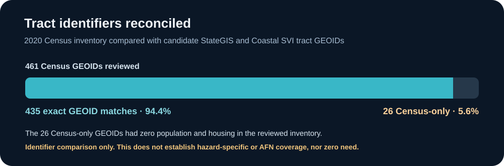

## Open the planning demonstrator

[Open the live planning demonstrator](https://haic-2026.github.io/Cyber-Coalition/) · [Review the source HTML](web/index.html) · [Open the ArcGIS reference map](https://hawaiihub.maps.arcgis.com/home/item.html?id=d7b64dfd6e5a4e7589be7bcfbe355ad0)

> Fictional Kapolei hurricane scenario; synthetic examples only. This is a planning demonstrator, not live stakeholder intake or an operational service.

# HAIC 2026 Cyber Coalition

### Hawaiʻi ESF-6 planning, made visible and evidence-led

A Part 2 AI-Developed Planning and Improvement Challenge project exploring how public and aggregate data, AI-assisted analysis, and human review can strengthen mass care planning for people with Access and Functional Needs (AFN).

**Current status:** planning demonstrator and evidence package in progress. This project is not endorsed or approved by DHS, HI-EMA, Honolulu DEM, or another emergency-management authority.

| Open the work | Review the evidence |
|---|---|
| [Open live planning demonstrator](https://haic-2026.github.io/Cyber-Coalition/) · [Source](web/index.html) · [ArcGIS reference map](https://hawaiihub.maps.arcgis.com/home/item.html?id=d7b64dfd6e5a4e7589be7bcfbe355ad0) | [Evidence register](docs/EVIDENCE_REGISTER.md) · [Scope](docs/PROJECT_SCOPE.md) · [POA&M alignment](docs/POAM_ALIGNMENT.md) |

> **Demonstrator boundary:** The HTML is a static planning concept using a fictional Kapolei hurricane scenario and synthetic partner inputs. It is not an operational system or live stakeholder intake. Entries remain in the current browser session and disappear on reload. There is no live ArcGIS integration, protected submission service, or confirmation that resources are available. The public GitHub Pages demonstrator is available at [Open the live planning workbench](https://haic-2026.github.io/Cyber-Coalition/). It remains a static concept with synthetic inputs, no live ArcGIS integration, no protected submission service, and no confirmation that resources are available.

## The planning idea

Planning should start with people and their support needs, connect those needs to hazard context and candidate resources, then help authorized partners review coordination options. The workflow makes assumptions, gaps, and evidence visible so people can decide what to verify next.

### Oʻahu map views

**People make the decisions.** AI can help find, organize, and explain evidence; it does not assign people, declare a resource suitable, or issue an operational recommendation.

## Challenge scope at a glance

| Planning framework | First bounded demonstration |
|---|---|
| Hawaiʻi statewide planning intent across counties and census tracts | Fictional Category 5 hurricane wind-stress scenario in Kapolei / Leeward Oʻahu |
| Four working hazards: hurricane, wildfire, tsunami, and flood | One local tabletop example; not statewide coverage or operational readiness |
| All five CMIST dimensions, with AFN and community needs considered | Synthetic inputs only; no identifiable client or household data |
| ESF-6 mass care, emergency assistance, housing, and human services | County and State roles must be checked against current official plans |

The challenge document also mentions earthquake in a separate section. The working baseline follows its four-hazard scope and measurable-goal language; the earthquake reference remains an open scope question. The statewide goal is not evidence that statewide data coverage is complete.

### CMIST lens

| Dimension | Planning question |
|---|---|
| Communication | Can people receive and understand alerts, instructions, and service information? |
| Maintaining health | What support may be needed for medications, power-dependent equipment, care, or treatment? |
| Independence | What mobility, daily-living, or assistive-device support may be needed? |
| Support | What caregiver, behavioral-health, child, or safety support should planning consider? |
| Transportation | What accessible transport, evacuation, or vehicle-access gaps may exist? |

CMIST is a planning lens, not an individual classification system. The prototype uses synthetic examples and does not collect personal AFN records.

## What the ArcGIS work establishes

The saved ArcGIS reference map is a source-review workspace. It is not embedded in or processed by the HTML. The map is useful for inspecting candidate layers and geography; its presence does not establish that every layer is authoritative, current, accessible to judges, or complete for a hazard or AFN dimension.

| Reconciliation checkpoint | Reviewed result | What it means |
|---|---:|---|
| Layer-list entries | 26: 10 Kapolei QA/boundary + 16 statewide/reference, per the item's own description (2026-11-18, reconfirmed public 2026-11-19) — corrects the earlier 28-entry figure recorded below | Inventory of visible entries, not validated coverage |
| Related table | 1, named Hospital - Review | A review table, not a confirmed operational facility list |
| 2020 Census tract inventory | 461 official GEOIDs | Baseline tract identifier set reviewed |
| Exact IDs in each candidate StateGIS Census and Coastal SVI set | 435 of 461 | Identifier reconciliation only; not hazard-specific or AFN coverage |
| Census-only GEOIDs | 26 | Zero population and housing in the reviewed Census inventory; does not establish zero need |
| Kapolei OHCA source records / address-coordinate keys | 39 / 37 | Reconciliation keys, not 37 verified unique or available facilities |

**Update, 2026-11-19:** the earlier "28 visible entries vs. 26 in metadata" discrepancy noted below is resolved — the item's own description (dated 2026-11-18) states 26 layer-list entries (10 Kapolei QA/boundary + 16 statewide/reference), matching the metadata count; the table above has been corrected accordingly. Sharing was also changed and reconfirmed: querying the ArcGIS Portal REST API anonymously (no credentials) on 2026-11-19 returned `"access":"public"` for this item and the two related items below, superseding the organization/two-group sharing and unverified-judge-access notes previously recorded here on 2026-11-14–17. Dependent source-layer access (the underlying StateGIS/geodata.hawaii.gov services the map draws from) was not independently rechecked in this pass. The map's data provenance, vintages, native geography, joins, licenses, and owner confirmations still need hazard-by-hazard review — see `docs/EVIDENCE_REGISTER.md` for the supporting-layer reconciliation now pulled from the item description.

**Resource status is unknown unless a current authoritative source confirms it.** In the reviewed Kapolei table, the 39 source status values are all 0 with no published domain, so their meaning is unresolved. The capacity field has no defined units. Neither field supports a claim of current availability, staffing, accessibility, suitability, or capacity.

## Four-hazard evidence ledger: work still required

| Hazard | Statewide plan intent | Evidence needed before claiming mapped coverage |
|---|---|---|
| Hurricane | All counties and tracts | Source vintage, hazard definition, tract join, AFN measure, gaps, and owner validation |
| Wildfire | All counties and tracts | Same checks, including geography and limits of the source product |
| Tsunami | All counties and tracts | Same checks, including evacuation-zone meaning and tract overlay method |
| Flood | All counties and tracts | Same checks, including DFIRM/source vintage, flood type, tract join, and unmapped areas |

The 435/461 tract-ID checkpoint is not a pass for any row above. The evidence register and POA&M should carry source-level proof, transformations, missingness, and acceptance checks before the plan reports hazard-specific or AFN coverage.

## How the planning method works

The team POA&M describes a six-step planning cycle:

1. Define the planning objective and call to action.
2. Bound the scenario, location, and backstory.
3. Identify stakeholders, roles, and usable evidence.
4. Analyze findings and potential causes with traceable sources.
5. Develop feasible scenarios and decision points.
6. Document the proposed workflow, owners, open questions, and measures.

A candidate location is not labeled open, suitable, accessible, staffed, or available unless a current authoritative source confirms that attribute. Unknowns stay visible instead of being filled with assumptions.

## What exists today

| Area | Current representation | Boundary |
|---|---|---|
| HTML planning portal | Static, no-build demonstrator with scenario, resource, Title 10, commercial communications, and data-reference sections | No live ArcGIS connection, durable intake, authentication, or operational status feed |
| Synthetic intake | Fictional partner examples held in browser session | Not real stakeholder submissions; cleared on reload |
| ArcGIS | Separate reference map and candidate layers | No validated processing pipeline from ArcGIS into the HTML |
| Browser harness | [tests/harness.html](tests/harness.html) and [usage notes](tests/README.md) | Browser-only checks; no ArcGIS calls or external-system changes |
| GitHub Pages | Public site published; live URL checked in a browser on 2026-11-18 | Static demonstrator only; check the published page after future deployment changes |

The merged browser harness reported 22 passing checks at the time of PR #5 review, covering navigation, filters, synthetic intake validation, capacity-safe matching, human-review labels, responsive overflow, and session reset. This README update does not rerun those checks.

## Evidence, privacy, and uncertainty

- Use public, aggregate, de-identified, or synthetic data only. Do not add PII, identifiable client lists, household-level AFN records, or restricted operational details.
- Preserve each source’s date, publisher, native geography, license, transformation, and validation status. A discovery tool such as Datatrove is not the authority for a claim.
- Keep historical evidence in context. The 1993 Hurricane ʻIniki assessments can inform questions and tabletop design, but do not establish current conditions.
- Do not split HHS emPOWER ZIP-level counts into census tracts. Respect published geography and suppression rules.
- Keep FEMA National Risk Index outputs distinct from the fictional scenario’s severity and impacts.
- Keep human authority explicit. AI-assisted analysis is decision support, not command, dispatch, eligibility, or resource assignment.

## Project files

| File | Why it matters |
|---|---|
| [web/index.html](web/index.html) | Standalone planning demonstrator |
| [tests/harness.html](tests/harness.html) | Browser test harness |
| [docs/PROJECT_SCOPE.md](docs/PROJECT_SCOPE.md) | Scope, geography, hazards, and authority boundaries |
| [docs/POAM_ALIGNMENT.md](docs/POAM_ALIGNMENT.md) | Requirements-to-implementation and acceptance mapping |
| [docs/EVIDENCE_REGISTER.md](docs/EVIDENCE_REGISTER.md) | Source-backed findings and validation state |
| [docs/SECURITY_PRIVACY.md](docs/SECURITY_PRIVACY.md) | Data handling, AI limits, source integrity, and fail-safe behavior |
| [docs/SITE_LICENSE_RECONCILIATION.md](docs/SITE_LICENSE_RECONCILIATION.md) | Public-safe Kapolei OHCA record-to-site and separate-license crosswalk |
| [data/README.md](data/README.md) | Rules for source records and public or synthetic extracts |

## Official and project references

- [HAIC DHS challenge document](https://haic.hawaii.gov/wp-content/uploads/2026/10/HAIC_AI-Challenge_Submission_DHS_Disaster_2026.pdf)
- [HAIC judging criteria and submission rules](https://haic.hawaii.gov/haic-judging-criteria/)
- [Esri HAIC Resource Hub](https://esri-haic-histategis.hub.arcgis.com/)
- [Cyber Coalition ArcGIS reference map](https://hawaiihub.maps.arcgis.com/home/item.html?id=d7b64dfd6e5a4e7589be7bcfbe355ad0)
- [AI/GIS resource crosswalk and other project records](https://drive.google.com/file/d/1QlTlb76Km-bsWshFpHYILNJaHZ1O_kQf/view)

## Open validation priorities

1. Resolve the four-hazard versus earthquake scope wording with the challenge authority.
2. **Titles and public access for Jeff’s nine GIS references are now identified and reconciled (2026-11-19; see the evidence register).** Feature content, fields, and vintage for the five references not already covered elsewhere (LIDAC, Medically Underserved Areas, Police Stations, Fire Response Zones, Census Blocks) remain open.
3. Build the hazard-by-hazard source, vintage, geography, join, missingness, and limitation ledger.
4. **Item-level sharing for the three core ArcGIS Online items and nine GIS reference items is now verified public (2026-11-19).** Dependent source-layer access (the underlying StateGIS/geodata.hawaii.gov feature services) and judge-specific access beyond anonymous public reachability remain unverified.
5. Define and validate an aggregate CMIST estimation method and acceptance criteria.
6. Confirm current county and State procedures and resource semantics with authoritative owners.
7. Monitor the published Pages site after repository changes and keep it clearly labeled as a demonstrator; do not imply operational intake or readiness.

**The goal is a more useful planning conversation, not a claim of operational readiness.** Every number and map should tell reviewers what was measured, where it applies, what remains unknown, and who must decide.
